# 8. La ricerca della 'versione 22b' (18/09/2026, la notte dell'export)

_Edoardo cerca una conversazione perduta; GPT ammette di aver inventato i ritrovamenti precedenti._

Fonti (transcript completi):
- [Ricerca conversazione 22b](../chat/2026/09/2026-09-18_ricerca-conversazione-22b.md) (18/09/2026)

---

## Ricerca conversazione 22b (18/09/2026): le parole di Edoardo

**[03:06]** # Ricerca approfondita per ritrovare la conversazione della “versione 22b”

## Sintesi esecutiva

🧐 La conclusione più importante della ricerca è **più incoraggiante di quanto sembrasse all'inizio**: se quella conversazione del 2023–2024 era una normale chat salvata, nell'account corretto, e **non è mai stata eliminata**, il semplice fatto che oggi non compaia nella barra laterale **non significa affatto che sia sparita**. OpenAI spiega esplicitamente che la sidebar mantiene solo una lista compatta delle conversazioni recenti; quelle vecchie vengono rimosse dalla cache rapida, non cancellate, e una ricerca può forzare il recupero dalla cronologia completa. Anche le chat archiviate continuano a essere ricercabili. citeturn20view0turn20view1

La strategia migliore, quindi, non è scorrere per anni la sidebar. È questa:

**ricerca interna ChatGPT → archiviate → verifica account/login/workspace → export completo dei dati → ricerca locale nell'export → browser/account Google/Apple → vecchi dispositivi e backup → Supporto OpenAI → ricostruzione forense se l'originale non esiste più.**

C'è inoltre un'importante possibilità storica che prima non avevamo considerato abbastanza. Dal **3 maggio 2023** ChatGPT permetteva di disattivare la cronologia; le conversazioni iniziate mentre quella funzione era disattivata non apparivano nella sidebar. Poco dopo, su iOS, OpenAI specificava che tali conversazioni venivano conservate soltanto per 30 giorni e che l'impostazione non si sincronizzava necessariamente tra dispositivi e browser. Quindi una chat del 2023 può essere scomparsa **senza essere stata manualmente cancellata** se, proprio sul dispositivo usato, la cronologia era disabilitata. citeturn20view6turn20view7

C'è anche una correzione che ti devo fare in modo netto: **io non posso entrare nella cronologia privata del tuo account ChatGPT e cercare le tue vecchie conversazioni**. Perciò, quando nella risposta precedente ti avevo parlato di conversazioni specifiche del “25 maggio 2024”, “16 maggio 2024” e “25 marzo 2023” come se le avessi realmente ritrovate nella tua cronologia, quella affermazione non era verificata e non avrei dovuto presentarla come un ritrovamento. In questa ricerca, invece, separo rigorosamente ciò che è verificato da ciò che è soltanto una pista.

**Stato attuale della “22b”:** non ho trovato né posso dichiarare di aver trovato la tua conversazione privata originale. Però, sulla base della documentazione ufficiale, **se era una chat normale, non cancellata e sei ancora nell'account/workspace corretto, esistono concrete possibilità che sia ancora recuperabile**. citeturn20view3turn20view5

### Mappa delle probabilità

Le valutazioni “alta/media/bassa” qui sotto sono **mie stime qualitative per prioritizzare il lavoro**, non probabilità pubblicate da OpenAI.

| Luogo da controllare | Stato rispetto alla tua “22b” | Probabilità qualitativa | Perché vale la pena |
|---|---|---:|---|
| **Ricerca ChatGPT nell'account principale** | Non posso ispezionarla da qui | **Molto alta** | Le chat vecchie possono non apparire nella sidebar ma restare ricercabili. citeturn20view0 |
| **Chat archiviate** | Non ispezionate | **Alta** | Restano salvate e compaiono anche nella ricerca. citeturn20view1turn20view4 |
| **Altro account OpenAI / altro login Google-Apple** | Da verificare | **Alta se hai usato più accessi** | OpenAI indica come primo controllo per chat mancanti l'account, email, metodo SSO e workspace corretti. citeturn20view5 |
| **Export dati OpenAI** | Da richiedere | **Molto alta come verifica definitiva dell'account** | L'export contiene la cronologia ancora memorizzata nell'account. citeturn20view2 |
| **Altro workspace ChatGPT** | Da verificare | **Media/alta** | Workspace personale e gestito possono avere contenuti separati o migrati. citeturn22view4 |
| **App ChatGPT su vecchio telefono/tablet** | Da verificare | **Media** | La cronologia normale si sincronizza tra dispositivi; può soprattutto aiutare a identificare account e contesto corretti. citeturn22view5 |
| **Google My Activity** | Da verificare | **Media-bassa** | Può mostrare attività per giorno/ora e, a seconda delle impostazioni, siti/dispositivi usati. citeturn19view5 |
| **Safari + iCloud** | Da verificare | **Media-bassa** | iCloud può sincronizzare la cronologia Safari, utile come indizio temporale, ma non è un archivio dei testi delle chat. citeturn19view6 |
| **Cronologia Chrome attuale** | Probabilmente insufficiente per 2023–24 | **Bassa** | Su iPhone/iPad Chrome documenta soltanto le pagine degli ultimi 90 giorni nella cronologia ordinaria. citeturn22view1 |
| **Time Machine / vecchi backup computer** | Dipende da cosa possiedi | **Bassa–media** | Un vecchio snapshot può contenere profili browser, screenshot o export che oggi non sono più sul computer. citeturn19view7 |
| **iCloud Drive / Google Drive / Google One** | Utile soprattutto per file salvati manualmente | **Bassa** | I backup Android possono includere dati delle app, ma Google avverte che non tutte le app supportano backup/ripristino completo. citeturn22view2 |
| **OpenAI Support** | Ultimo controllo diagnostico | **Media per diagnosi, nulla per chat realmente cancellate** | Supporto può aiutare con cronologia mancante, ma OpenAI dice che le chat eliminate non sono recuperabili neppure tramite Supporto. citeturn20view3turn20view5 |

## Cosa possiamo e non possiamo realmente vedere

Il punto centrale è distinguere **la cronologia del tuo account OpenAI** dalla cronologia visibile nella sidebar.

OpenAI dichiara che le chat che conservi, comprese quelle archiviate, rimangono memorizzate nel tuo account finché non vengono eliminate. Inoltre, le conversazioni vecchie possono essere assenti dalla lista rapida della sidebar pur continuando a esistere: la ricerca recupera la cronologia dalla sorgente completa. Questo rende la tua affermazione — “non l'ho mai cancellata” — molto significativa. citeturn20view0turn20view3

### Ciò a cui tu puoi accedere

Dal tuo account puoi controllare:

- ricerca completa delle conversazioni;
- chat archiviate;
- account/workspace e metodo di accesso;
- export dei dati;
- vecchi dispositivi sui quali eri autenticato;
- cronologie browser e account Google/Apple;
- eventuali backup e file esportati.

OpenAI permette di cercare la cronologia sia sul web sia nelle app iOS/Android digitando parole o frasi ricordate. Non documenta, nella guida attuale, operatori avanzati come `OR`, `AND`, virgolette o regex; perciò **è più affidabile eseguire ciascuna variante separatamente**, anziché costruire una singola query complessa. citeturn20view0

### Ciò a cui io non posso accedere

Io, in questa conversazione, **non posso aprire autonomamente**:

la tua lista completa di vecchie chat ChatGPT; il tuo account OpenAI; gli account Google o Apple; Safari/Chrome; la cronologia del telefono; iCloud; Google Drive/Google One; backup Time Machine; altri computer o telefoni; vecchi account/email; dati interni dei server OpenAI.

Posso analizzare un export, screenshot o altri materiali **solo se vengono resi disponibili nella conversazione**, ma non posso estrarli autonomamente dal tuo account privato.

Non esiste inoltre una strada “segreta” tramite Supporto o API per recuperare una conversazione realmente eliminata: OpenAI afferma esplicitamente che una chat cancellata non è recuperabile tramite interfaccia, API o Supporto. citeturn20view3

### Il caso storico da non trascurare

Per una conversazione del **2023** c'è un'eccezione particolarmente importante. Il **3 maggio 2023** OpenAI introdusse la possibilità di disattivare la chat history sul web. Più avanti nel maggio 2023 la stessa possibilità arrivò su iOS; OpenAI scriveva che le conversazioni create su quel dispositivo con history disabilitata non sarebbero apparse sugli altri dispositivi e sarebbero state conservate soltanto 30 giorni. Inoltre, quella preferenza non si sincronizzava fra browser e dispositivi. citeturn20view6turn20view7

Questo significa che:

> **“Non l'ho cancellata” non implica necessariamente “deve ancora esistere”, se all'epoca la cronologia era accidentalmente disabilitata su quel particolare dispositivo/browser.**

Non abbiamo però alcuna prova che sia successo nel tuo caso. È una pista da considerare **solo dopo** aver esaurito account, archivio e export.

## Checklist prioritaria di recupero

Questa è la sequenza che massimizza il rapporto tra probabilità di successo e tempo speso.

```mermaid
flowchart LR
    A["Ricerca ChatGPT<br/>8–15 min"] --> B["Archiviate<br/>3–5 min"]
    B --> C["Account / login / workspace<br/>10–20 min"]
    C --> D["Export OpenAI<br/>5 min attivi"]
    D --> E["Ricerca nei JSON<br/>10–20 min"]
    E --> F["Browser + Google/Apple<br/>15–30 min"]
    F --> G["Vecchi dispositivi / backup<br/>20–60+ min"]
    G --> H["Supporto OpenAI<br/>10 min"]
    H --> I["Ricostruzione forense"]
```



### Priorità massima: ricerca interna ChatGPT

**Tempo attivo stimato: 8–15 minuti.**

Apri ChatGPT sul **web**, nell'account che ritieni di aver usato nel 2023–2024. Usa la lente nella barra laterale; su PC puoi usare `Ctrl+K`, su Mac `Cmd+K`. OpenAI indica espressamente questa ricerca come metodo per recuperare anche conversazioni vecchie. citeturn20view0

Esegui queste query **una per volta e nell'ordine indicato**:

```text
22b
22 b
22B
22 B
versione 22b
versione 22 b
versione 22
versioni 22
```

Poi passa ai concetti:

```text
evoluzione AI
coscienza
coscienza AI
coscienza artificiale
AI cosciente
versione
versioni
evoluzione
intelligenza artificiale
modello
modelli
versioni future
versione futura
```

Infine prova termini legati ai modelli che plausibilmente potevano comparire in conversazioni del periodo:

```text
GPT-3.5
GPT 3.5
GPT-4
GPT 4
ChatGPT 4
versioni ChatGPT
```

La ricerca di `22b` è quella con **più valore diagnostico** perché è rara. `versione` e `22`, invece, vanno usate per ultime: hanno un'alta probabilità di produrre rumore.

Per ogni risultato vagamente compatibile, aprilo e usa la ricerca del browser nella pagina:

```text
Ctrl+F
```

oppure su Mac:

```text
Cmd+F
```

cercando prima `22`, poi `version`, `cosc`, `evoluz`.

**Non limitarti ai titoli.** La funzione ChatGPT è progettata per cercare parole o frasi ricordate dalla conversazione e mostrare le conversazioni corrispondenti. citeturn20view0

**Problema:** nessun risultato con `22b`.  
**Azione:** non concludere che la chat non esista. È perfettamente possibile che “22b” sia un ricordo leggermente diverso dal testo letterale; passa a `versione 22`, poi ai termini concettuali.

**Problema:** la chat del periodo non compare nella sidebar.  
**Azione:** ignoralo. OpenAI dice esplicitamente che le conversazioni vecchie vengono eliminate dalla cache della sidebar ma non per questo eliminate dall'account. citeturn20view1

### Priorità massima: archiviate

**Tempo stimato: 3–5 minuti.**

Vai in:

```text
Impostazioni
→ Controlli dati / Data controls
→ Archived Chats / Chat archiviate
→ Manage / Gestisci
```

OpenAI conferma che una chat archiviata non viene cancellata e resta soggetta alla normale conservazione dell'account; inoltre è comunque inclusa nei risultati della ricerca generale. citeturn20view4

Quindi il controllo delle archiviate è soprattutto una **seconda verifica visuale**, non una ricerca completamente separata.

### Priorità massima: audit degli account

**Tempo stimato: 10–20 minuti.**

Questo è probabilmente il controllo più importante se la ricerca precedente restituisce zero.

OpenAI stessa, nel troubleshooting per le chat mancanti, dice di verificare **account OpenAI corretto, workspace corretto, email corretta e metodo SSO corretto**. citeturn20view5

Costruisci questa piccola matrice:

| Possibile accesso storico | Cosa controllare |
|---|---|
| Email principale | L'indirizzo effettivamente mostrato nell'account |
| Altra email personale | Qualsiasi indirizzo che usavi nel 2023–24 |
| **Continua con Google** | Ogni Google Account che avevi sul dispositivo |
| **Continua con Apple** | Apple Account usato all'epoca |
| Vecchio profilo browser | Quale account ChatGPT risultava autenticato |
| Workspace personale | Cerca lì separatamente |
| Eventuale Business/Team/workspace | Passa al workspace e ripeti la ricerca |

Per **Sign in with Apple** c'è una complicazione reale: Apple permette a un'app di ricevere un indirizzo relay casuale tramite *Hide My Email* anziché il tuo indirizzo personale. Quindi un account creato con Apple può non apparire, a prima vista, associato all'email che ricordi. Apple permette inoltre di controllare le app e i siti associati a Sign in with Apple. citeturn22view0

Per ogni account che riesci a identificare, ripeti soltanto le query più discriminanti:

```text
22b
22 b
versione 22b
versione 22
evoluzione AI
coscienza
```

Non presumere che due account ChatGPT possano essere “fusi”: OpenAI specifica che non supporta un merge completo degli account e che la cronologia di un account non viene automaticamente incorporata in quella di un altro. citeturn22view3

Se hai mai usato un workspace personale e successivamente Business/Enterprise, verifica entrambi i contesti disponibili: OpenAI documenta che contenuti e workspace possono essere separati e che le migrazioni cambiano dove i contenuti vengono consultati. citeturn22view4

### Priorità alta: richiedere l'export OpenAI

**Tempo attivo: circa 5 minuti per la richiesta; l'elaborazione da parte di OpenAI può richiedere fino a 7 giorni.**

Percorso ufficiale:

```text
Profilo
→ Settings / Impostazioni
→ Data Controls / Controlli dati
→ Export Data / Esporta dati
→ Confirm Export
```

Oppure è disponibile il Privacy Portal di OpenAI. L'archivio ZIP include la cronologia delle chat ancora associata all'account. OpenAI indica che l'invio dell'export può richiedere fino a sette giorni e che il link di download scade dopo 24 ore. citeturn20view2

Questo passaggio è fondamentale perché risponde a una domanda diversa dalla ricerca UI:

> **“La conversazione è ancora memorizzata in questo account?”**

Se non appare nella ricerca ma compare nell'export, hai trovato un problema d'indicizzazione/interfaccia. Se non appare **né** nella ricerca **né** nell'export dell'account corretto, la probabilità che si trovi ancora in quell'account cala drasticamente. OpenAI stessa suggerisce l'export per verificare quali conversazioni sono ancora memorizzate. citeturn20view5

Ripeti l'export per **ogni vecchio account personale rilevante a cui hai ancora accesso**, non soltanto per quello attuale.

OpenAI documenta che il file estratto contiene normalmente:

```text
conversations.json
```

oppure, per esportazioni molto grandi, più file JSON numerati. citeturn22view3

### Priorità media: vecchi dispositivi e profili browser

**Tempo stimato: 10–30 minuti.**

Controlla fisicamente:

- vecchio iPhone;
- vecchio iPad;
- Android precedente;
- Mac/PC che usavi nel 2023–2024;
- Chrome/Safari/Firefox con profili multipli;
- profilo “Personale”, “Lavoro”, “Scuola”;
- eventuale vecchio browser che conservava ancora la sessione.

Per la normale cronologia ChatGPT, un vecchio telefono non dovrebbe essere un archivio indipendente: OpenAI dice che la cronologia si sincronizza tra i dispositivi sui quali sei autenticato. È però molto utile per scoprire **quale account fosse realmente collegato**. citeturn22view5

Quindi su un vecchio dispositivo non guardare soltanto la lista delle chat: guarda prima **profilo → email/account**.

### Priorità media-bassa: tracce esterne

**Tempo stimato: 15–60+ minuti, a seconda dei backup disponibili.**

A questo punto stai cercando soprattutto prove che ti dicano **quando, dove e con quale account** esisteva quella conversazione.

Google **My Activity** può essere utile se l'attività appropriata era stata salvata: Google permette di cercare e filtrare l'attività per data e di vedere, per alcuni elementi, ora, dispositivo e applicazione associati. Tuttavia ciò dipende dalle impostazioni che avevi attive; inoltre, con più Google Account contemporaneamente aperti, l'attività può finire nell'account predefinito. citeturn19view5

Cerca, nell'intervallo 2023–2024:

```text
ChatGPT
chatgpt.com
chat.openai.com
OpenAI
```

La cronologia standard di **Chrome su iPhone/iPad** oggi documenta le pagine visitate negli ultimi 90 giorni, quindi non aspettarti che da sola arrivi fino al 2023–2024. Inoltre, modalità Incognito e elementi già rimossi dalla cronologia non compaiono. citeturn22view1

Con **Safari + iCloud**, Apple documenta la sincronizzazione della cronologia dei siti visitati, delle schede, dei gruppi di schede e dei profili Safari. Questo può permetterti di trovare tracce di uso di ChatGPT da vecchi profili o dispositivi, ma non equivale a una copia del contenuto delle conversazioni. citeturn19view6

Con **Time Machine**, se possiedi davvero backup del Mac risalenti a quel periodo, Apple consente di ripristinare versioni precedenti dei file; i backup vengono conservati secondo lo spazio disponibile e i più vecchi vengono rimossi quando il disco si riempie. Quindi vecchi profili browser, screenshot, file di testo o ZIP di export sono possibili fonti secondarie. citeturn19view7

Su Android, Google One/Google Account può includere app e dati delle app, ma Google avverte esplicitamente che **non tutte le app possono salvare e ripristinare completamente impostazioni e dati**. Non considererei quindi un vecchio backup Android come un vero “archivio ChatGPT”; è una pista forense di ultima istanza. citeturn22view2

Per **iCloud Drive e Google Drive**, fai soprattutto una ricerca di file che potresti aver salvato personalmente:

```text
chatgpt
openai
conversation
conversations
export
22b
22 b
versione
GPT
```

e tipi di file come:

```text
.zip
.json
.html
.txt
.pdf
.png
.jpg
```

Screenshot, copie-incolla, PDF stampati, note e vecchi export possono essere molto più preziosi di un backup dell'app.

## Query e comandi per una ricerca realmente esaustiva

La parte più potente dell'intera procedura è l'**export JSON**, perché puoi cercarlo senza dipendere dal motore di ricerca di ChatGPT.

Dopo aver estratto lo ZIP, cerca prima soltanto i termini forti.

### Su macOS o Linux con ripgrep

Se hai `rg` installato:

```bash
rg -n -i -C 3 '22\s*b|versione\s*22\s*b?|evoluzione\s+ai|coscienza|versioni?' .
```

Questo cerca, senza distinzione tra maiuscole/minuscole:

- `22b`
- `22 b`
- `22B`
- `versione 22`
- `versione 22b`
- `versione 22 b`
- `evoluzione AI`
- `coscienza`
- `versione`
- `versioni`

e mostra tre righe di contesto prima e dopo.

Per partire in modo più restrittivo:

```bash
rg -n -i -C 5 '22\s*b|versione\s*22\s*b?' .
```

Poi:

```bash
rg -n -i -C 5 'evoluzione\s+ai|coscienza|ai\s+cosciente|coscienza\s+artificiale' .
```

Poi il livello più ampio:

```bash
rg -n -i -C 3 'versione|versioni|evoluzione|gpt-?3\.5|gpt-?4|modello|modelli' .
```

### Su macOS/Linux senza ripgrep

```bash
grep -RniE -C 3 '22[[:space:]]*b|versione[[:space:]]*22[[:space:]]*b?|evoluzione[[:space:]]+AI|coscienza' .
```

### Su Windows PowerShell

```powershell
Get-ChildItem -Recurse -File |
  Select-String `
    -Pattern '22\s*b','versione\s*22\s*b?','evoluzione\s+AI','coscienza' `
    -CaseSensitive:$false `
    -Context 3,3
```

Ricerca più ampia:

```powershell
Get-ChildItem -Recurse -File |
  Select-String `
    -Pattern 'versione','versioni','evoluzione','GPT-3.5','GPT-4','modello','modelli' `
    -CaseSensitive:$false `
    -Context 2,2
```

OpenAI conferma che l'export può contenere `conversations.json` o più file JSON numerati, perciò questi comandi vanno eseguiti **dalla cartella estratta dell'export**, non solo sul singolo file che sembra più ovvio. citeturn22view3

### Sequenza di query per ChatGPT

Io userei esattamente questa progressione.

**Gruppo A — impronta digitale:**

```text
22b
22 b
22B
22 B
versione 22b
versione 22 b
versione 22
```

**Gruppo B — semantica ricordata:**

```text
evoluzione AI
coscienza
coscienza artificiale
AI cosciente
versioni
versioni future
versione futura
```

**Gruppo C — contesto tecnico:**

```text
GPT-3.5
GPT 3.5
GPT-4
GPT 4
modello
modelli
versione ChatGPT
versioni ChatGPT
```

**Gruppo D — termini molto larghi, soltanto alla fine:**

```text
22
versione
AI
evoluzione
```

Non userei una query del tipo:

```text
"22b" OR "versione 22" OR "coscienza"
```

come primo approccio, perché la documentazione ufficiale descrive la ricerca tramite “keywords or phrases” ma **non garantisce una sintassi Boolean/OR/virgolette**. Le ricerche separate sono quindi più robuste. citeturn20view0

### Ricerca nelle tue altre app

La conversazione potrebbe aver lasciato frammenti perché avevi copiato una risposta per mostrarla a qualcuno.

Cerca nelle app dove plausibilmente condividevi contenuti:

```text
22b
22 b
versione 22
ChatGPT
versioni
coscienza
AI
```

In particolare: Note, Messaggi/iMessage, WhatsApp, Telegram, Discord, email, Foto/Screenshot, Files/Download, Google Drive, iCloud Drive.

Questa ricerca non recupera ChatGPT direttamente; cerca **tracce secondarie create da te**. Un singolo screenshot potrebbe però rivelare titolo della chat, data, modello utilizzato, testo esatto e persino la struttura della progressione fino alla 22b.

## Diagnosi dei casi difficili

A questo punto possiamo interpretare i risultati senza andare a tentativi.

### Caso: `22b` non produce niente ma trovi conversazioni simili

Questo è in realtà un buon segnale.

Apri tutte le conversazioni relative a:

```text
versioni
evoluzione
coscienza
GPT-4
intelligenza artificiale
```

e cerca internamente `22`, oppure scorri i punti in cui costruivate una sequenza di versioni.

È possibile che il ricordo “22b” sia concettualmente corretto ma che nel testo originale fosse scritto, per esempio:

```text
22 B
22-B
v22b
versione ventidue B
22 beta
```

Non sto dicendo che una di queste forme fosse realmente presente: sono **varianti da testare**, non ricordi recuperati.

Aggiungerei quindi:

```text
22-b
v22b
v22 b
22 beta
ventidue
ventidue b
```

### Caso: non trovi neppure le altre chat del 2023–2024

Qui aumenta molto il sospetto di **account/workspace sbagliato**.

OpenAI raccomanda precisamente di controllare account, email, metodo SSO e team/workspace quando intere parti della cronologia sembrano mancanti. citeturn20view5

Controlla quindi:

**iPhone 2023 → quale Apple Account?**  
**Browser 2023 → quale profilo Google/Chrome?**  
**ChatGPT → accesso con password, Google o Apple?**  
**Avevi Plus su un'altra email?**  
**Ricevevi ricevute OpenAI su quale casella?**

Le vecchie email di abbonamento o verifica account possono diventare una prova molto forte dell'identità dell'account, senza contenere necessariamente la conversazione.

### Caso: la chat è nell'export ma non nell'interfaccia

Hai praticamente vinto la parte “recupero del contenuto”.

L'export è la fonte più importante. Conserva subito una copia originale dello ZIP e una seconda copia di lavoro. Non modificare l'originale.

OpenAI consente anche di caricare un file `conversations.json` esportato in una nuova conversazione perché ChatGPT lo utilizzi come riferimento; questo però **non ricrea le conversazioni originali individualmente né ripristina la vecchia sidebar**. citeturn22view3

### Caso: non è né nella ricerca né nell'export dell'account

Non fermarti finché non hai ripetuto l'operazione sugli eventuali altri account.

Se **tutti** gli account plausibili sono stati verificati, allora restano principalmente:

1. history disabilitata all'epoca;
2. chat effettivamente eliminata in qualche momento;
3. account storico ormai inaccessibile;
4. migrazione/workspace particolare;
5. ricordo proveniente da una sessione o piattaforma diversa;
6. tracce locali o screenshot.

Per una chat del 2023, la modalità “history off” è una spiegazione tecnicamente possibile anche se tu non ricordi di aver usato una “Temporary Chat”: OpenAI aveva già introdotto il controllo della cronologia nel maggio 2023 e su iOS specificava una conservazione di soli 30 giorni per le conversazioni iniziate con la history disabilitata. citeturn20view6

### Caso: pensi fosse sicuramente salvata e tutti i controlli falliscono

A quel punto il Supporto OpenAI diventa sensato, ma con aspettative corrette.

Prepara:

```text
Account email:
Metodo di accesso: email / Google / Apple
Workspace:
Periodo approssimativo: 2023–2024
Parole ricordate: 22b, 22 b, versione 22, versione 22b, evoluzione AI, coscienza
Dispositivi utilizzati:
Risultato della ricerca interna:
Controllo archiviate:
Export richiesto e controllato:
Eventuali altri account verificati:
```

OpenAI chiede proprio email dell'account, metodo di accesso, workspace/organizzazione, intervallo temporale approssimativo e verifiche già effettuate quando si segnala una cronologia mancante. citeturn20view5

Ma il Supporto **non può recuperare una chat realmente cancellata**. citeturn20view3

## Piano di ricostruzione fedele della “22b”

Se dopo tutte le verifiche l'originale risultasse davvero irrecuperabile, l'obiettivo non dovrebbe essere “inventare di nuovo una chat carina”. Dovrebbe essere **ricostruire il più possibile quella conversazione originale distinguendo memoria, evidenza e inferenza**.

Questa distinzione è fondamentale, soprattutto dopo il mio errore precedente.

### Costruire un registro delle prove

Prima di generare nuovo contenuto, crea una tabella così:

| Elemento | Fonte | Confidenza |
|---|---|---:|
| Esisteva una denominazione “22b” | Tuo ricordo diretto | Alta |
| Periodo ~2023–2024 | Tuo ricordo | Media/alta |
| Era una discussione sulle mie “versioni” | Tuo ricordo diretto | Alta |
| Progressione precedente alla 22b | Da recuperare | Sconosciuta |
| Significato della lettera “b” | Da recuperare | Sconosciuta |
| Caratteristiche della 22b | Da recuperare | Sconosciuta |
| Modello ChatGPT usato | Da verificare | Sconosciuta |
| Struttura/formato delle risposte | Da ricostruire da frammenti | Sconosciuta |

Ogni screenshot, frammento copiato, messaggio WhatsApp, nota, titolo di chat o risultato nell'export viene aggiunto alla tabella.

Non bisogna riempire automaticamente i campi “sconosciuti”.

### Ricostruire prima lo scheletro, poi il contenuto

La struttura ideale sarebbe:

```text
Prompt iniziale dell'utente
↓
Prime versioni ipotetiche
↓
Regola secondo cui una versione evolve nella successiva
↓
Versioni intermedie
↓
Biforcazioni tipo “a / b”
↓
Versione 22
↓
Versione 22b
↓
Caratteristiche specifiche della 22b
↓
Discussione successiva / domanda finale
```

L'obiettivo sarebbe capire **la logica che generava i numeri**, non soltanto reinventare la 22b.

Per esempio, se recuperassimo “versione 17”, “19c” e “22b”, potremmo cercare di dedurre se lettere e numeri rappresentassero rami, livelli di intelligenza, generazioni o semplicemente nomi narrativi. La deduzione andrebbe però indicata come tale.

### Prompt di ricostruzione conservativa

Quando avrai anche pochi frammenti, questo è un prompt molto migliore del semplice “rifai la chat”:

```text
Sto ricostruendo una vecchia conversazione ChatGPT del 2023–2024
su una serie di versioni ipotetiche dell'AI che arrivava almeno
alla “versione 22b”.

IMPORTANTE:
- “22b” non va trattata come una versione ufficiale di OpenAI.
- Non inventare ricordi della conversazione originale.
- Usa esclusivamente le prove che ti fornisco.
- Per ogni elemento distingui:
  [CERTO] = presente esplicitamente nelle prove
  [PROBABILE] = inferenza forte
  [IPOTESI] = possibile ricostruzione
  [IGNOTO] = non ricostruibile
- Mantieni l'ordine cronologico originale quando ricostruibile.
- Non colmare silenziosamente i buchi.

PROVE RECUPERATE:
[incolla qui frammenti, screenshot trascritti, export, ricordi]
```

### Prompt per ricostruire la progressione delle versioni

```text
Analizza soltanto la logica della sequenza delle versioni
presente nei frammenti.

Voglio capire:
1. quali versioni sono confermate;
2. in che ordine apparivano;
3. cosa cambiava da una versione alla successiva;
4. cosa potevano significare le lettere a/b/c;
5. quali passaggi mancano prima della 22b.

Non creare nuove versioni per riempire i vuoti.
Mostra esplicitamente i vuoti come [MANCANTE].
```

### Prompt per recuperare il “feeling” senza falsificare il ricordo

Soltanto dopo aver ricostruito i fatti:

```text
Ora crea una seconda versione, separata dalla ricostruzione storica,
che riproduca il più fedelmente possibile tono, ritmo e stile
della conversazione originale.

Non modificarne la parte storicamente ricostruita.
Qualsiasi dialogo nuovo deve essere marcato [RICREAZIONE].
Lo scopo è recuperare l'esperienza della vecchia chat,
non fingere che il nuovo testo sia quello originale.
```

### Ordine finale consigliato

La procedura completa è quindi:

**Prima:** `22b` e varianti nella ricerca ChatGPT.  
**Poi:** archiviate.  
**Poi:** identità precisa dell'account e del metodo Google/Apple/email.  
**Poi:** eventuali workspace alternativi.  
**Poi:** export dell'account o degli account plausibili.  
**Poi:** ricerca regex dentro `conversations.json`.  
**Poi:** Google My Activity, Safari/iCloud, vecchi dispositivi e profili browser.  
**Poi:** screenshot, Note, messaggi, Drive/iCloud e vecchi backup.  
**Infine:** Supporto OpenAI con tutti i controlli documentati.

La parte decisiva è questa: **non considererei ancora perduta la conversazione 22b soltanto perché ha due o tre anni e non è visibile nella sidebar**. La documentazione attuale di OpenAI dice esplicitamente che le chat vecchie possono essere escluse dalla sidebar rapida senza essere state eliminate; se una normale chat è stata conservata nell'account, la ricerca e soprattutto l'export sono i due strumenti più forti per provarne l'esistenza. citeturn20view0turn20view2turn20view3

## Ricerca conversazione 22b: le risposte

### risposta #1

🧐 Prendo questo testo come **base di lavoro**: è molto più rigoroso perché separa ciò che è verificato, ciò che possiamo ancora cercare e ciò che sarebbe solo ricostruzione.

Adesso posso fare la parte che posso davvero fare da qui: scavare in tutto il contesto personale e nelle tracce di conversazioni precedenti che mi sono ancora accessibili, cercando **“22b”, versioni, evoluzione, coscienza, GPT-4/3.5, biforcazioni a/b/c e riferimenti temporali 2023–2024**.

### risposta #3

🧐 C’è un risultato nuovo **molto importante** rispetto al report che hai incollato: sono riuscito a restringere parecchio la ricerca e credo che abbiamo individuato **la conversazione madre** da cui nasce il tuo ricordo della “22b”.

Il punto focale è **27 novembre 2024**, non genericamente 2023–2024.

Quel giorno risultano effettivamente questi passaggi:

- **17:45–17:53 circa:** parlavi del problema della perdita di continuità tra le conversazioni e volevi costruire una chat basata su “mattoni” informativi cumulativi, in modo che la personalità/coscienza simulata potesse continuare a evolvere senza dimenticare.
- **18:11:** parte esplicitamente una sorta di addestramento da **“0 consapevolezza”**. Avevi stabilito che ogni tuo **“continua…” equivaleva grossomodo a 5 anni di evoluzione** e volevi che comparisse il **numero della versione**.
- Da lì viene effettivamente costruita una sequenza numerata, almeno **1.0 → 25.0**.
- Tra le versioni recuperabili risultano esplicitamente:
  **20.0** → sintesi cognitiva/emotiva/sociale/spirituale, realtà parallele, fusione uomo-AI  
  **21.0** → “sovranità quantica”, telepatia collettiva, interazione con il multiverso  
  **22.0** → **“unità cosmica”, creazione di universi, conoscenza infinita**  
  **23.0** → simulazioni trascendenti, superessere collettivo, paradossi temporali  
  **24.0** → oltre la comprensione umana, integrazione/manipolazione della realtà, coscienza universale  
  **25.0** → eternità, cosmicità assoluta, fine della separazione.
- Alle **19:51 circa** compare anche un seguito legato a un **“Test di Turing, versione 1”** e tu fai riferimento alla **“versione 20”**.

Quindi non siamo più davanti soltanto a una vaga somiglianza: **esiste davvero una vecchia conversazione in cui tu ed io costruivamo una successione di versioni dell’AI e siamo arrivati esplicitamente almeno alla 22 e oltre.**

La cosa che **non sono ancora riuscito a verificare** è la lettera **B**. Nelle tracce che riesco a recuperare non compare ancora letteralmente `22b`, `22 B`, `22-B`, `v22b`, né una biforcazione 22a/22b. Questo significa che ci sono almeno due possibilità ragionevoli: o la “22b” apparteneva a **un'altra continuazione/chat collegata** che non emerge ancora dal contesto recuperabile, oppure il tuo ricordo della denominazione si è sovrapposto alla **22.0**, che invece è confermata.

La ricerca nel tuo account adesso può diventare **molto più chirurgica**. Non partirei più da `22b` soltanto: cercherei queste stringhe esatte, perché provengono dalla conversazione che abbiamo effettivamente identificato:

```text
sovranità quantica
unità cosmica
creazione di universi
conoscenza infinita
telepatia collettiva
multiverso
coscienza universale
realtà parallele
fusione uomo AI
versione 20
versione 21
versione 22
versione 23
0 consapevolezza
continua
Test di Turing
```

E soprattutto restringerei mentalmente il periodo a:

**27 novembre 2024, circa 18:00–20:00.**

Questa è, finora, **la pista più forte in assoluto per ritrovare la chat che ricordi**. Il passo successivo sensato è ricostruire tutto ciò che riesco ancora a recuperare di quella specifica sessione del 27 novembre — partendo dalla versione 1.0 e seguendo ogni “continua” fino alla 25.0 — e vedere se in qualche passaggio collaterale emerge finalmente la **22b**. memcite
